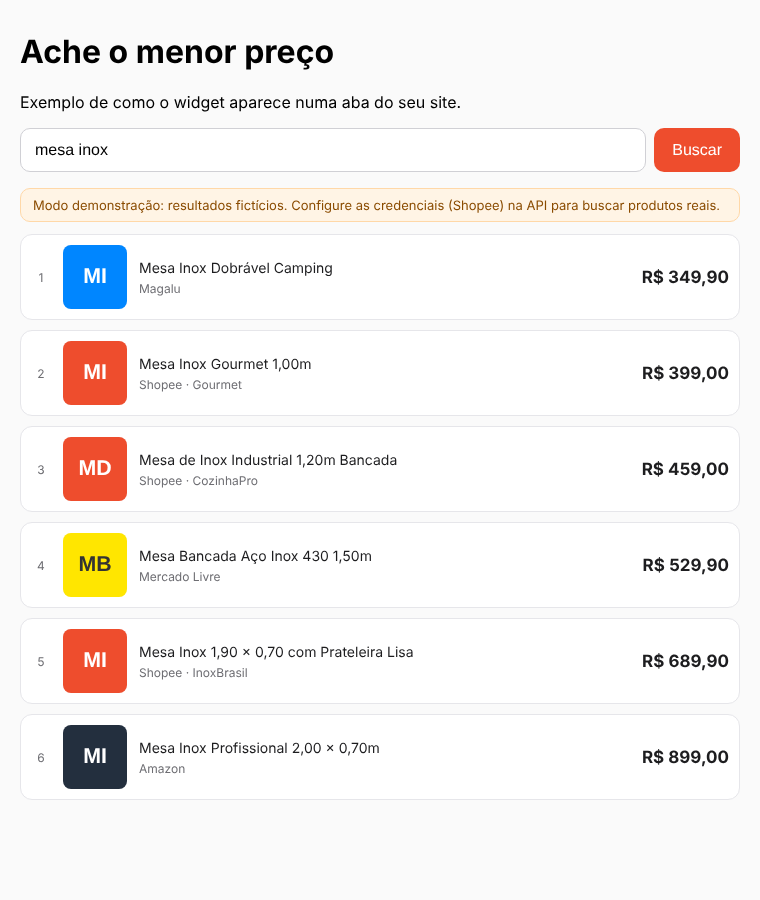

# Preço Certo — comparador de preços com links de afiliado (SaaS)

O visitante digita um produto (ex.: **"mesa inox"**), a API busca em várias lojas, filtra os itens
iguais/parecidos e devolve os **5 ou 10 mais baratos**. Quando ele clica, o link passa por `/go`,
que troca o link pelo **seu link de afiliado** (Shopee, Amazon, etc.) e redireciona.



## Como funciona

```
Seu site (widget.js) ──GET /api/search?q=mesa inox──▶ API
                                                      ├─ Shopee (API de Afiliados, oficial e grátis)
                                                      ├─ Mercado Livre (API pública, opcional)
                                                      └─ Google Shopping via SerpAPI (opcional)
                         ◀── top 10 por preço ────────┘   (filtro de similaridade + remove acessórios/duplicados)

Visitante clica ──GET /go?t=<token assinado>──▶ API decide o link:
   1. link de afiliado já pronto da fonte (offerLink da Shopee)
   2. afiliação do site cliente (Shopee short link / tag Amazon / deeplink genérico)
   3. afiliação da plataforma (você) — fallback opcional
   4. link original
 ──302──▶ loja
```

- O link de afiliado **nunca** vai pro navegador antes do clique; o `/go` usa token HMAC (não vira redirecionador aberto).
- Cada clique gera um log `{"type":"click",...}` — base para o painel de métricas do cliente.
- Busca é cacheada 1h por termo → economiza cota das APIs gratuitas.

## Rodar local

```bash
npm install
npm run dev        # sem credenciais sobe em MODO DEMO (catálogo fictício com poucos itens)
# abra http://localhost:3000/demo.html
npm test           # testes
```

## Colocar no seu site

```html
<div id="preco-certo"></div>
<script src="https://SUA-API/widget.js" data-key="SUA_API_KEY" data-limit="10" defer></script>
```

Ou consuma a API direto: `GET /api/search?key=...&q=mesa%20inox&limit=5&mode=similar|exact`.

## Credenciais (todas gratuitas)

| Fonte | Onde conseguir | Observação |
|---|---|---|
| Shopee | affiliate.shopee.com.br → Open API (precisa ser afiliado aprovado) | Busca + link de afiliado. É a peça principal. |
| Amazon | associados.amazon.com.br | Só a tag (`xxx-20`); a busca vem do Google Shopping. |
| Mercado Livre | developers.mercadolivre.com.br | Sem `MERCADOLIVRE_CLIENT_ID/SECRET` a busca responde 403; o token é gerado e renovado sozinho. O programa de afiliados do ML não tem API pública: use `templates` se tiver deeplink por outra rede. |
| SerpAPI | serpapi.com | Plano gratuito com cota mensal pequena. |

Copie `.env.example` → `.env` e `tenants.example.json` → `tenants.json` (cada site cliente é um *tenant*
com sua própria `apiKey`, origens permitidas e afiliações).

## Deploy custo zero

- **Vercel / Cloudflare Workers / Render (free)** — o app é Hono + Web Crypto, roda em qualquer um.
- Tenants via variável `TENANTS_JSON` enquanto forem poucos; depois migre para Supabase/Turso (free tier).

## Próximos passos para virar SaaS

1. Cadastro/login do cliente e painel para ele colar as credenciais de afiliado (guardar cifrado).
2. Gravar cliques em banco (Supabase) e mostrar relatório; cruzar com `subIds` da Shopee para conversões.
3. Rate limit por `apiKey` e planos (ex.: grátis até N buscas/mês).
4. Mais fontes com API de afiliado oficial: AliExpress Portals, Awin/Lomadee (Magalu, Americanas…).
